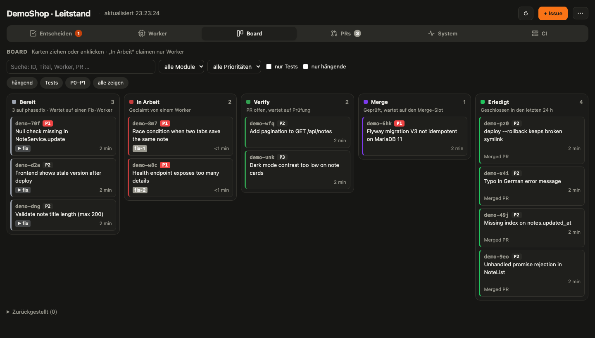
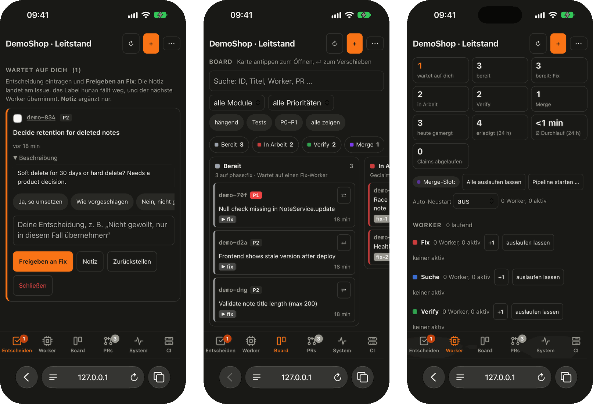
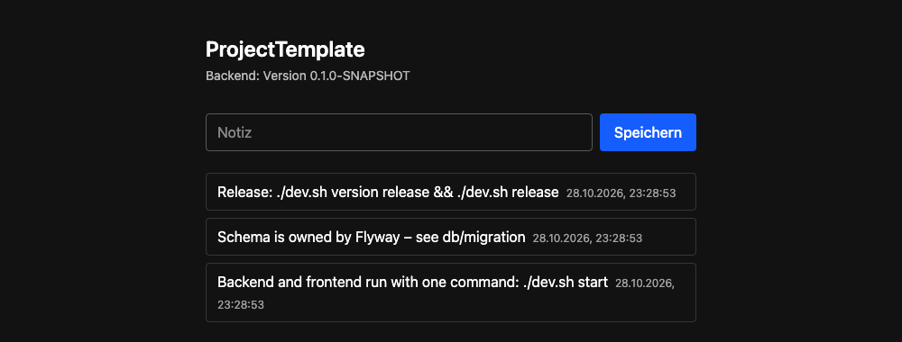

# ProjectTemplate

[English](README.md) · **Deutsch**


Ein sofort lauffähiges Fullstack-Gerüst (Spring Boot + React + MariaDB) mit einem `dev.sh`, das in
jedem Projekt gleich funktioniert – und einem optionalen Kit, mit dem mehrere Claude-Code-Sessions
parallel Fehler finden, beheben und prüfen.

## Was drinsteckt

- **App-Gerüst** – Spring Boot 3.5 (Java 17, JPA, Flyway, Actuator) · React 19 + Vite + TypeScript +
  Tailwind 4 · MariaDB per Docker Compose. Dazu Release-Paket und Server-Installer (systemd,
  nginx/HestiaCP) mit Health-Check und automatischem Zurückstellen.
- **devkit** – `dev.sh` und `scripts/devkit/` sind in allen Projekten identisch: starten, testen,
  Version, Release, Deploy. Was ein Projekt ausmacht, steht allein in seiner `dev.project.sh`.
  Änderungen gehen mit einem Befehl an alle Projekte.
- **beadskit** (optional) – parallele Claude-Code-Worker über eine gemeinsame
  [beads](https://github.com/gastownhall/beads)-Warteschlange, dazu ein Leitstand im Browser für alle Projekte.



Der Leitstand funktioniert auch auf dem Handy:



## Voraussetzungen

JDK 17, Maven, Node, Docker. Für beadskit zusätzlich [`bd`](https://github.com/gastownhall/beads)
und [Claude Code](https://claude.com/claude-code).

## Schnellstart

```bash
git clone https://github.com/felixgodo/ProjectTemplate
cd ProjectTemplate
./dev.sh start        # MariaDB (Docker), Backend, Frontend – Ctrl+C beendet alles
```

Dann http://localhost:5200 öffnen (Backend 8100, MariaDB 3310). `./dev.sh help` zeigt alle Befehle.



## Neues Projekt

```bash
./new-project.sh InvoiceHub                 # legt ../InvoiceHub an
./new-project.sh InvoiceHub --group com.example --prefix IH --backend-port 8105
cd ../InvoiceHub && ./dev.sh start
```

Kopiert das Template, benennt Paket, Artefakte, Dienst und Umgebungsvariablen um, wählt freie Ports
(nach den `dev.project.sh` der Nachbarprojekte) und trägt das Projekt in `devkit-projects.txt` ein.

## Einheitliche Befehle

| Befehl | |
|---|---|
| `./dev.sh start [dienst…] [--no-build]` | Infrastruktur, Build, dann alle Dienste im Vordergrund mit `[name]`-Präfix. Ctrl+C beendet alles. |
| `./dev.sh stop` | Infrastruktur anhalten, Reste eines früheren Starts beenden. Daten bleiben. |
| `./dev.sh status` · `logs [dienst]` | aus einem zweiten Terminal: Ports, Health, Version · Log mitlesen |
| `./dev.sh build [--tests]` · `test` · `clean` · `doctor` | |
| `./dev.sh version` | alle Stellen zeigen; Exit 1, wenn sie auseinanderlaufen |
| `./dev.sh version patch\|minor\|major\|release\|snapshot\|1.2.3` | überall setzen (POMs, package.json, …) |
| `./dev.sh release [--skip-tests] [--no-build] [--force]` | Paket bauen |
| `./dev.sh deploy [--host H] [--dry-run] [--yes] [--install] [--status\|--rollback\|--logs]` | auf den Server bringen |
| `./dev.sh backup [run\|list\|status]` | auf die Storage Box sichern |
| `./dev.sh self-update [--check]` | devkit aus diesem Template übernehmen |

Dazu kommen je Projekt eigene Befehle – `./dev.sh help` zeigt sie. Release und Deploy im Detail:
[README.project.md](README.project.md).

## devkit ändern und verteilen

`devkit-projects.txt` listet die Projekte, die den devkit beziehen. Die Datei bleibt lokal (nicht
versioniert): `cp devkit-projects.txt.example devkit-projects.txt`.

```bash
# 1. hier in scripts/devkit/ ändern, scripts/devkit/VERSION hochzählen
./devkit-sync.sh              # Stand je Projekt
./devkit-sync.sh --apply      # in alle Projekte aus devkit-projects.txt übernehmen
# oder im einzelnen Projekt:  ./dev.sh self-update
```

Ein bestehendes Projekt mit eigenem `dev.sh` erstmals umstellen:

```bash
./devkit-sync.sh --adopt MeinProjekt   # sichert dessen dev.sh als dev.sh.vor-devkit, legt devkit + dev.sh an
# danach in ../MeinProjekt eine dev.project.sh schreiben und in devkit-projects.txt eintragen
```

`--apply` fasst nur Projekte an, die schon eine `dev.project.sh` haben, und überschreibt nie ein
`dev.sh`, das nicht aus dem devkit stammt. Schnittstelle (Variablen, Hooks, Versions-Regeln):
[scripts/devkit/README.de.md](scripts/devkit/README.de.md).

## Parallele Worker (beadskit)

Mehrere Claude-Code-Sessions arbeiten über eine gemeinsame beads-Warteschlange (`bd`) an einem
Projekt, jede in einer Rolle:

- **Such-Worker** prüfen den Code und legen Funde an,
- **Fix-Worker** übernehmen sie und öffnen Pull Requests,
- **Verify-Worker** prüfen und mergen diese PRs,
- **Regress-Worker** prüfen danach den Ziel-Branch.

Der Leitstand im Browser zeigt Warteschlangen, Worker und PRs aller eingerichteten Projekte.

```bash
./beadskit-sync.sh --adopt MeinProjekt --base main --modules "backend frontend"
cd ../MeinProjekt && bd init --prefix meinprojekt     # einmalig, .beads/ bleibt lokal
scripts/beadskit/workers start fix=1 search=1 verify=1
./leitstand.sh                                       # http://127.0.0.1:3738, alle Projekte
./beadskit-sync.sh --apply                           # Kit-Änderungen verteilen (VERSION hochzählen)
```

Details: [scripts/beadskit/README.de.md](scripts/beadskit/README.de.md)

## Zwei Rechner (optional)

Ein Linux-PC (Ubuntu Server) kann Worker, Builds und Docker übernehmen und hält die gemeinsame
beads-Datenbank und den Leitstand; ein Mac arbeitet mit, wenn er frei ist. Einrichtung:
[scripts/remote/README.de.md](scripts/remote/README.de.md).

## Aufbau

```
dev.sh · dev.project.sh · scripts/devkit/     Steuerung
pom.xml                                       Parent: Version, Node-Version, Plugins
backend/                                      Spring Boot – /api/ping, /api/version, Beispiel /api/notes
frontend/                                     React + Vite, Proxy /api → Backend
docker-compose.yml                            MariaDB für die Entwicklung
deploy/                                       setup.sh und Vorlagen fürs Release-Paket
scripts/beadskit/                             parallele Claude-Worker + Leitstand (optional je Projekt)
scripts/remote/                               zweiter Rechner (Linux-PC): Einrichtung, pc-Befehl
new-project.sh · devkit-sync.sh · beadskit-sync.sh · leitstand.sh   nur im Template
```

## Lizenz

[MIT](LICENSE)
