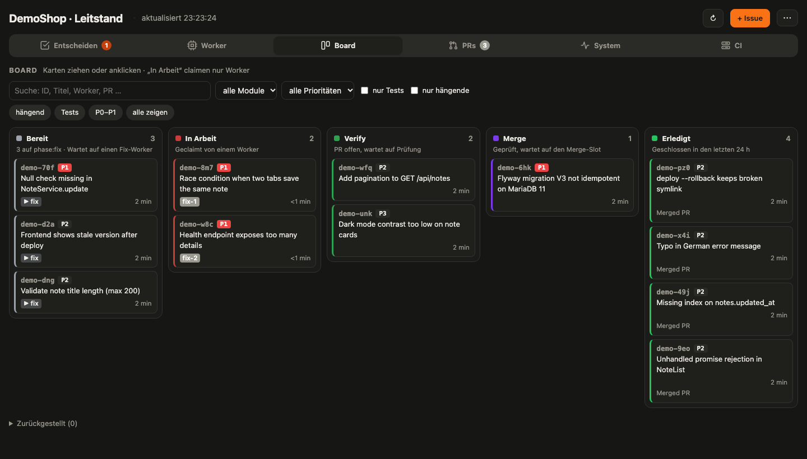
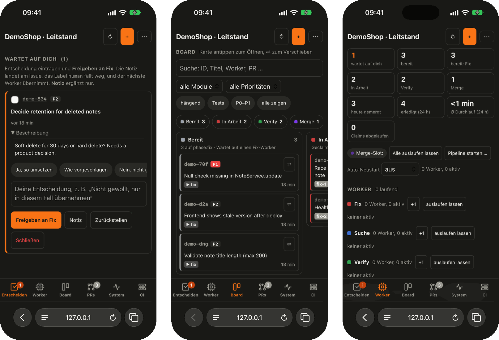
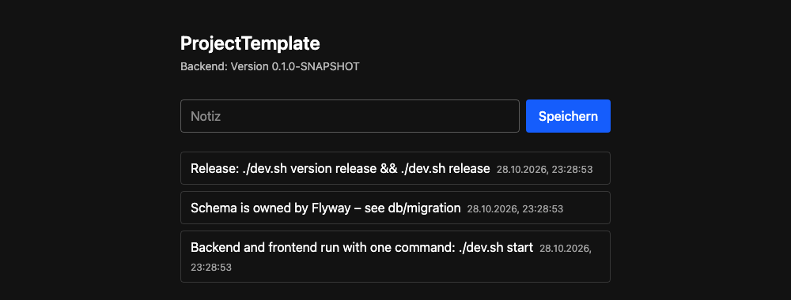
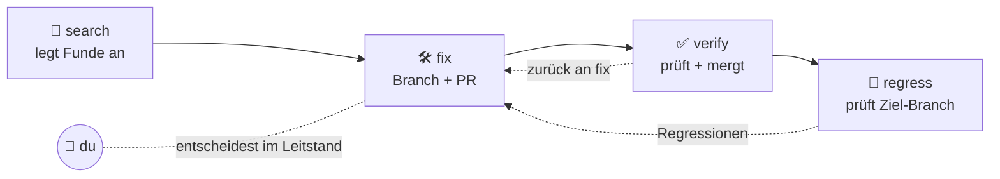

<div align="center">

# ProjectTemplate

**Ein Fullstack-Gerüst, in dem ein Team aus Claude-Code-Agenten parallel Fehler findet, behebt,
prüft und mergt – und du alles in einem Leitstand verfolgst und steuerst.**

[English](README.md) · **Deutsch**

[](https://github.com/felixgodo/ProjectTemplate/actions/workflows/ci.yml)
[](https://github.com/felixgodo/ProjectTemplate/stargazers)


[](LICENSE)

[Schnellstart](#-schnellstart) · [Funktionen](#-funktionen) · [KI-Worker](#-parallele-ki-worker-beadskit) · [FAQ](#-faq)



</div>

## 💡 Warum?

- **Ein `dev.sh` für jedes Projekt.** Starten, testen, Version, Release und Deploy funktionieren
  überall gleich. Was ein Projekt ausmacht, steht allein in seiner `dev.project.sh`.
- **Vom ersten Tag an produktionsreif.** Release-Paket, Server-Installer (systemd, nginx/HestiaCP),
  Health-Check und automatisches Zurückrollen sind schon da.
- **Ein KI-Entwicklerteam auf deinem Rechner.** Mehrere Claude-Code-Sessions arbeiten über eine
  gemeinsame Warteschlange: eine sucht Fehler, eine behebt, eine prüft und mergt, eine sucht Regressionen.
- **Du behältst die Kontrolle.** Der *Leitstand* zeigt alles, was auf deine Entscheidung wartet – am
  Schreibtisch oder auf dem Handy.
- **Selbst gehostet.** Dein Code, deine Rechner, deine CI-Runner.

## ✨ Funktionen

| | |
|---|---|
| 🧱 **App-Gerüst** | Spring Boot 3.5 (Java 17, JPA, Flyway, Actuator) · React 19 + Vite + TypeScript + Tailwind 4 · MariaDB per Docker Compose |
| 🚀 **Release & Deploy** | `./dev.sh release` baut das Paket, `./dev.sh deploy` bringt es auf den Server – mit Health-Check, `--rollback` und Backups |
| 🔁 **devkit** | identische Werkzeuge in allen Projekten, mit einem Befehl verteilt |
| 🤖 **beadskit** *(optional)* | parallele Claude-Code-Worker über eine [beads](https://github.com/gastownhall/beads)-Warteschlange, Rollen *search → fix → verify → regress* |
| 🖥️ **Leitstand** | Browser-Dashboard für alle Projekte: Entscheidungen, Worker, Kanban-Board, PRs, System, CI, Tokens |
| 📱 **Mobil** | läuft auf dem iPhone, als Web-App auf den Home-Bildschirm, optional sicherer Fernzugriff |
| 🧠 **Modell je Rolle** | z. B. Opus zum Beheben, Haiku zum Suchen – per Kommandozeile oder im Start-Dialog |
| 📡 **Remote Control** | Worker erscheinen auf claude.ai/code und in der Claude-App: mitlesen, schreiben, Rückfragen beantworten |
| 📊 **Token-Übersicht** | Verbrauch je Modell und Rechner, Wochen- und 5-Stunden-Limit mit Hochrechnung |
| 🏭 **CI-Runner-Pool** | selbst gehostete GitHub-Runner für alle Projekte, auch über zwei Rechner |
| 🖧 **Zwei Rechner** | ein Linux-PC übernimmt Worker, Builds und Docker; der Mac arbeitet mit, wenn er frei ist |

<p align="center">
  
</p>

## 🚀 Schnellstart

**Voraussetzungen:** JDK 17, Maven, Node, Docker. Für die KI-Worker zusätzlich
[`bd`](https://github.com/gastownhall/beads) und [Claude Code](https://claude.com/claude-code).

```bash
git clone https://github.com/felixgodo/ProjectTemplate
cd ProjectTemplate
./dev.sh start        # MariaDB (Docker), Backend, Frontend – Ctrl+C beendet alles
```

Dann **http://localhost:5200** öffnen (Backend 8100, MariaDB 3310). `./dev.sh help` zeigt alle Befehle.



### Eigenes Projekt anlegen

```bash
./new-project.sh InvoiceHub                 # legt ../InvoiceHub an
./new-project.sh InvoiceHub --group com.example --prefix IH --backend-port 8105
cd ../InvoiceHub && ./dev.sh start
```

Kopiert das Template, benennt Paket, Artefakte, Dienst und Umgebungsvariablen um, wählt freie Ports
(nach den `dev.project.sh` der Nachbarprojekte) und trägt das Projekt in `devkit-projects.txt` ein.

## 🤖 Parallele KI-Worker (beadskit)



Jeder Worker ist eine Claude-Code-Session in einer Rolle. Alle teilen sich eine beads-Warteschlange,
nichts wird doppelt gemacht, und alles, was einen Menschen braucht, landet in **„Wartet auf dich“**.

**In vier Schritten eingerichtet:**

```bash
./beadskit-sync.sh --adopt MeinProjekt --base main --modules "backend frontend"   # 1. Kit einrichten
cd ../MeinProjekt && bd init --prefix meinprojekt                                 # 2. Warteschlange (.beads/ bleibt lokal)
scripts/beadskit/workers start fix=1 search=1 verify=1                            # 3. Worker starten
./leitstand.sh                                                                    # 4. http://127.0.0.1:3738
```

**Praktische Extras:**

```bash
scripts/beadskit/workers start --model fix=claude-opus-5-5 --model search=haiku   # Modell je Rolle
scripts/beadskit/workers start --rc            # Remote Control: Worker auf claude.ai/code und in der App verfolgen
scripts/beadskit/workers interval search 2m    # Abstand der /loop-Runden einer Rolle (--off: Standard)
scripts/beadskit/workers add fix               # ein Fixer mehr
scripts/beadskit/workers drain                 # aktuellen Schritt fertig machen, nichts Neues nehmen
scripts/beadskit/workers top                   # Live-Übersicht: Rechner, Projekte, Worker
```

### Der Leitstand

Ein Prozess für alle Projekte, oben Projekt- und Workspace-Umschalter:

- **Entscheiden** – Rückfragen und Issues, die auf dich warten, mit Mehrfachauswahl und Antworten zum Antippen
- **Worker** – Kennzahlen, Starten/Stoppen/+1, Modell und `/loop`-Abstand je Rolle, Chat mit einem Worker, Neustart bei großem Kontext
- **Board** – Kanban mit Drag & Drop je Workspace
- **PRs** – Pull Requests mit CI-Status über alle Repos
- **System** – CPU, RAM, Platte, Temperatur und Dienste je Rechner (und deiner Server)
- **CI** – Plätze des Runner-Pools, Warteschlange, Grenzen je Projekt, PR vorziehen
- **Tokens** – Verbrauch je Modell und Rechner, Wochen- und 5-Stunden-Limit in Prozent mit Hochrechnung

Projekte können über eine optionale `beads.leitstand.mjs` eigene Buttons, Spalten, Listen und Links ergänzen.

📖 Alles im Detail: [scripts/beadskit/README.de.md](scripts/beadskit/README.de.md)

## 🖧 Zwei Rechner (optional)

Ein Linux-PC (Ubuntu Server) kann Worker, Builds und Docker übernehmen und hält die gemeinsame
beads-Datenbank und den Leitstand; ein Mac arbeitet mit, wenn er frei ist. Der CI-Runner-Pool kann
auf beiden laufen. Einrichtung: [scripts/remote/README.de.md](scripts/remote/README.de.md).

## 📚 Referenz

<details>
<summary><b>Alle <code>dev.sh</code>-Befehle</b></summary>

| Befehl | |
|---|---|
| `./dev.sh start [dienst…] [--no-build]` | Infrastruktur, Build, dann alle Dienste im Vordergrund mit `[name]`-Präfix. Ctrl+C beendet alles. |
| `./dev.sh stop` | Infrastruktur anhalten, Reste eines früheren Starts beenden. Daten bleiben. |
| `./dev.sh status` · `logs [dienst]` | aus einem zweiten Terminal: Ports, Health, Version · Log mitlesen |
| `./dev.sh build [--tests]` · `test` · `clean` · `doctor` | |
| `./dev.sh version` | alle Stellen zeigen; Exit 1, wenn sie auseinanderlaufen |
| `./dev.sh version patch\|minor\|major\|release\|snapshot\|1.2.3` | überall setzen (POMs, package.json, …) |
| `./dev.sh release [--skip-tests] [--no-build] [--force]` | Paket bauen |
| `./dev.sh deploy [--host H] [--dry-run] [--yes] [--install] [--status\|--rollback\|--logs]` | auf den Server bringen |
| `./dev.sh backup [run\|list\|status]` | auf die Storage Box sichern |
| `./dev.sh self-update [--check]` | devkit aus diesem Template übernehmen |

Dazu kommen je Projekt eigene Befehle – `./dev.sh help` zeigt sie. Release und Deploy im Detail:
[README.project.md](README.project.md).

</details>

<details>
<summary><b>devkit und beadskit über Projekte verteilen</b></summary>

`devkit-projects.txt` listet die Projekte, die den devkit beziehen. Die Datei bleibt lokal (nicht
versioniert): `cp devkit-projects.txt.example devkit-projects.txt`.

```bash
# 1. hier in scripts/devkit/ ändern, scripts/devkit/VERSION hochzählen
./devkit-sync.sh              # Stand je Projekt
./devkit-sync.sh --apply      # in alle Projekte aus devkit-projects.txt übernehmen
# oder im einzelnen Projekt:  ./dev.sh self-update

./beadskit-sync.sh --apply    # dasselbe für beadskit (scripts/beadskit/VERSION hochzählen)
```

Ein bestehendes Projekt mit eigenem `dev.sh` erstmals umstellen:

```bash
./devkit-sync.sh --adopt MeinProjekt   # sichert dessen dev.sh als dev.sh.vor-devkit, legt devkit + dev.sh an
# danach in ../MeinProjekt eine dev.project.sh schreiben und in devkit-projects.txt eintragen
```

`--apply` fasst nur Projekte an, die schon eine `dev.project.sh` haben, und überschreibt nie ein
`dev.sh`, das nicht aus dem devkit stammt. Schnittstelle (Variablen, Hooks, Versions-Regeln):
[scripts/devkit/README.de.md](scripts/devkit/README.de.md).

</details>

<details>
<summary><b>Aufbau</b></summary>

```
dev.sh · dev.project.sh · scripts/devkit/     Steuerung
pom.xml                                       Parent: Version, Node-Version, Plugins
backend/                                      Spring Boot – /api/ping, /api/version, Beispiel /api/notes
frontend/                                     React + Vite, Proxy /api → Backend
docker-compose.yml                            MariaDB für die Entwicklung
deploy/                                       setup.sh und Vorlagen fürs Release-Paket
scripts/beadskit/                             parallele Claude-Worker + Leitstand (optional je Projekt)
scripts/remote/                               zweiter Rechner (Linux-PC): Einrichtung, pc-Befehl
new-project.sh · devkit-sync.sh · beadskit-sync.sh · leitstand.sh   nur im Template
```

</details>

## ❓ FAQ

**Brauche ich die KI-Worker?**
Nein. beadskit ist je Projekt optional. Ohne bekommst du ein sauberes Spring-Boot-+-React-Gerüst mit
einheitlichem `dev.sh`.

**Wie behalte ich Verbrauch und Limits im Blick?**
Der Tab **Tokens** zeigt den Verbrauch je Modell und Rechner sowie dein Wochen- und 5-Stunden-Limit.
Einmal je Rechner `node scripts/beadskit/leitstand/usage-statusline.mjs install --apply` ausführen,
damit die Limit-Prozente erfasst werden. Günstigere Modelle für einzelne Rollen (`--model search=haiku`)
helfen ebenfalls.

**Läuft das unter Linux?**
Ja. Auf dem Mac laufen die Worker als iTerm-Tabs, unter Linux als tmux-Fenster
(`workers attach <name>`); `--bg` startet sie im Hintergrund.

**Kann ich meine Worker vom Handy aus verfolgen?**
Ja – den Leitstand auf dem Handy öffnen (`leitstand-remote` richtet einen sicheren Zugang ein) oder
Worker mit `--rc` starten und in der Claude-App verfolgen. Remote Control braucht einen
claude.ai-Login, keinen API-Key.

**Wo liegen die Issues?**
In einer lokalen [beads](https://github.com/gastownhall/beads)-Datenbank (`.beads/`, nicht in Git).
Mit zwei Rechnern teilen sie sich eine Datenbank.

## 🤝 Mitmachen

Issues, Ideen und Pull Requests sind sehr willkommen! Änderungen an den Kits passieren hier im
Template und gehen mit `./devkit-sync.sh --apply` / `./beadskit-sync.sh --apply` an die Projekte.

### ⭐ Wenn dir das Zeit spart, lass gern einen Stern da – so finden andere das Projekt.

## Lizenz

[MIT](LICENSE)
