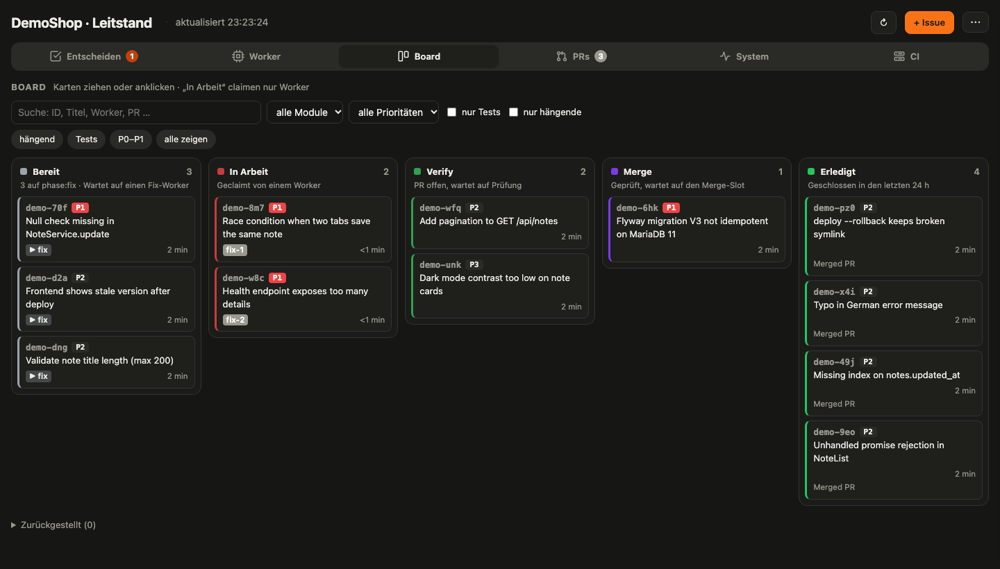
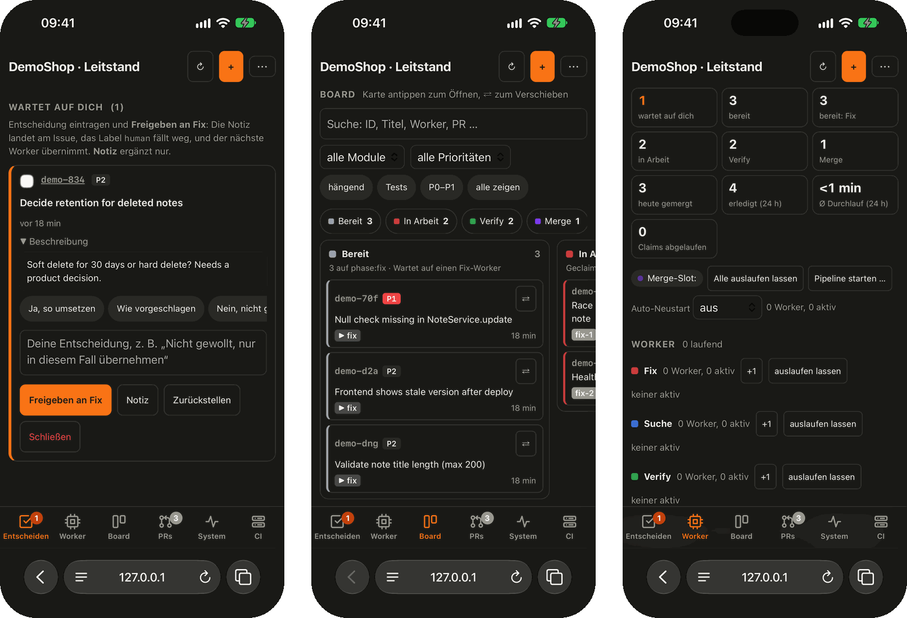
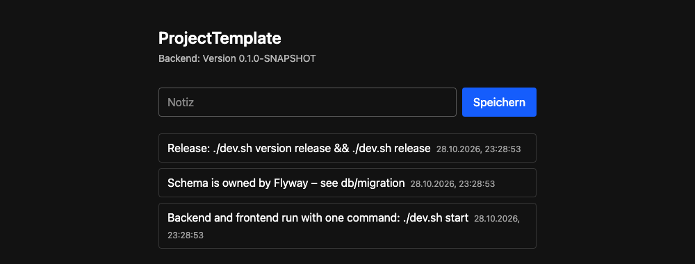
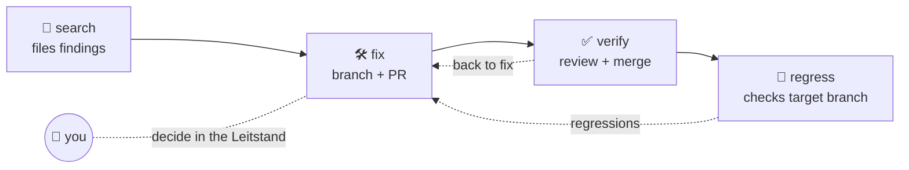

<div align="center">

# ProjectTemplate

**A full-stack starter where a team of Claude Code agents finds, fixes, reviews and merges issues
in parallel – and you watch and steer it all from one dashboard.**

**English** · [Deutsch](README.de.md)

[](https://github.com/felixgodo/ProjectTemplate/actions/workflows/ci.yml)
[](https://github.com/felixgodo/ProjectTemplate/stargazers)


[](LICENSE)

[Quick start](#-quick-start) · [Features](#-features) · [AI workers](#-parallel-ai-workers-beadskit) · [FAQ](#-faq)



</div>

## 💡 Why?

- **One `dev.sh` for every project.** Start, test, version, release and deploy work the same
  everywhere. What makes a project special lives in a single `dev.project.sh`.
- **Production-ready from day one.** Release package, server installer (systemd, nginx/HestiaCP),
  health check and automatic rollback are already there.
- **An AI dev team on your machine.** Several Claude Code sessions work through a shared issue
  queue: one searches for bugs, one fixes, one reviews and merges, one checks for regressions.
- **You stay in control.** The *Leitstand* (control room) shows everything that is waiting for your
  decision – on the desktop or on your phone.
- **Self-hosted.** Your code, your machines, your CI runners.

## ✨ Features

| | |
|---|---|
| 🧱 **App skeleton** | Spring Boot 3.5 (Java 17, JPA, Flyway, Actuator) · React 19 + Vite + TypeScript + Tailwind 4 · MariaDB via Docker Compose |
| 🚀 **Release & deploy** | `./dev.sh release` builds the package, `./dev.sh deploy` ships it – with health check, `--rollback` and backups |
| 🔁 **devkit** | identical tooling in all your projects, rolled out with one command |
| 🤖 **beadskit** *(optional)* | parallel Claude Code workers on a [beads](https://github.com/gastownhall/beads) queue, roles *search → fix → verify → regress* |
| 🖥️ **Leitstand** | browser dashboard for all projects: decisions, workers, kanban board, PRs, system, CI, tokens |
| 📱 **Mobile** | works on the iPhone, can be added to the home screen, optional secure remote access |
| 🧠 **Model per role** | e.g. Opus for fixing, Haiku for searching – per command line or in the start dialog |
| 📡 **Remote Control** | workers show up on claude.ai/code and in the Claude app: read along, chat, answer prompts |
| 📊 **Token tracking** | usage per model and machine, weekly and 5-hour limit with projection |
| 🏭 **CI runner pool** | self-hosted GitHub runners shared by all projects, across two machines |
| 🖧 **Two machines** | a Linux box takes over workers, builds and Docker; your Mac joins when it's free |

<p align="center">
  
</p>

## 🚀 Quick start

**Prerequisites:** JDK 17, Maven, Node, Docker. For the AI workers additionally
[`bd`](https://github.com/gastownhall/beads) and [Claude Code](https://claude.com/claude-code).

```bash
git clone https://github.com/felixgodo/ProjectTemplate
cd ProjectTemplate
./dev.sh start        # MariaDB (Docker), backend, frontend – Ctrl+C stops everything
```

Open **http://localhost:5200** (backend on 8100, MariaDB on 3310). `./dev.sh help` lists all commands.



### Create your own project

```bash
./new-project.sh InvoiceHub                 # creates ../InvoiceHub
./new-project.sh InvoiceHub --group com.example --prefix IH --backend-port 8105
cd ../InvoiceHub && ./dev.sh start
```

Copies the template and renames package, artifacts, service and environment variables. Free ports are
picked by looking at the `dev.project.sh` of neighbouring projects, and the project is added to
`devkit-projects.txt`.

## 🤖 Parallel AI workers (beadskit)



Each worker is a Claude Code session in a role. They share one beads queue, so nothing is done twice,
and everything that needs a human lands in **“Wartet auf dich”** (waiting for you).

**Set up in four steps:**

```bash
./beadskit-sync.sh --adopt MyProject --base main --modules "backend frontend"   # 1. install the kit
cd ../MyProject && bd init --prefix myproject                                   # 2. queue (.beads/ stays local)
scripts/beadskit/workers start fix=1 search=1 verify=1                          # 3. start workers
./leitstand.sh                                                                  # 4. http://127.0.0.1:3738
```

**Handy extras:**

```bash
scripts/beadskit/workers start --model fix=claude-opus-5-5 --model search=haiku   # model per role
scripts/beadskit/workers start --rc            # Remote Control: follow workers on claude.ai/code and in the app
scripts/beadskit/workers interval search 2m    # gap between /loop rounds of a role (--off: default)
scripts/beadskit/workers add fix               # one more fixer
scripts/beadskit/workers drain                 # finish the current step, claim nothing new
scripts/beadskit/workers top                   # live overview: machines, projects, workers
```

### The Leitstand

One process for all projects, with a project and workspace switcher at the top:

- **Entscheiden** (decide) – prompts and issues waiting for you, with multi-select and tap-to-use answers
- **Worker** – metrics, start/stop/+1, model and `/loop` interval per role, chat with a worker, auto-restart on large context
- **Board** – kanban with drag & drop per workspace
- **PRs** – pull requests with CI status across all repos
- **System** – CPU, RAM, disk, temperature and services per machine (and your servers)
- **CI** – runner pool slots, queue, limits per project, move a PR to the front
- **Tokens** – usage per model and machine, weekly and 5-hour limit in percent with a projection

Projects can add their own buttons, columns, lists and links via an optional `beads.leitstand.mjs`.

📖 Everything in detail: [scripts/beadskit/README.md](scripts/beadskit/README.md)

## 🖧 Two machines (optional)

A Linux box (Ubuntu Server) can take over workers, builds and Docker and host the shared beads
database and the Leitstand, while a Mac joins in when it's free. The CI runner pool can run on both.
Setup: [scripts/remote/README.md](scripts/remote/README.md).

## 📚 Reference

<details>
<summary><b>All <code>dev.sh</code> commands</b></summary>

| Command | |
|---|---|
| `./dev.sh start [service…] [--no-build]` | Infrastructure, build, then all services in the foreground with a `[name]` prefix. Ctrl+C stops all. |
| `./dev.sh stop` | Stop infrastructure and leftovers of an earlier start. Data is kept. |
| `./dev.sh status` · `logs [service]` | From a second terminal: ports, health, version · follow a log |
| `./dev.sh build [--tests]` · `test` · `clean` · `doctor` | |
| `./dev.sh version` | Show every place the version lives; exit 1 if they diverge |
| `./dev.sh version patch\|minor\|major\|release\|snapshot\|1.2.3` | Set it everywhere (POMs, package.json, …) |
| `./dev.sh release [--skip-tests] [--no-build] [--force]` | Build the release package |
| `./dev.sh deploy [--host H] [--dry-run] [--yes] [--install] [--status\|--rollback\|--logs]` | Ship it to the server |
| `./dev.sh backup [run\|list\|status]` | Back up to the storage box |
| `./dev.sh self-update [--check]` | Pull the devkit from this template |

Projects add their own commands – `./dev.sh help` shows them. Release and deploy in detail:
[README.project.md](README.project.md).

</details>

<details>
<summary><b>Sharing the devkit and beadskit across projects</b></summary>

`devkit-projects.txt` lists the projects that use the devkit. It stays local (not versioned):
`cp devkit-projects.txt.example devkit-projects.txt`.

```bash
# 1. change scripts/devkit/ here, bump scripts/devkit/VERSION
./devkit-sync.sh              # status per project
./devkit-sync.sh --apply      # roll out to all projects in devkit-projects.txt
# or inside a single project:  ./dev.sh self-update

./beadskit-sync.sh --apply    # same for beadskit (bump scripts/beadskit/VERSION)
```

Switching an existing project with its own `dev.sh`:

```bash
./devkit-sync.sh --adopt MyProject   # backs up its dev.sh as dev.sh.vor-devkit, installs devkit + dev.sh
# then write a dev.project.sh in ../MyProject and add it to devkit-projects.txt
```

`--apply` only touches projects that already have a `dev.project.sh` and never overwrites a `dev.sh`
that doesn't come from the devkit. Interface (variables, hooks, version rules):
[scripts/devkit/README.md](scripts/devkit/README.md).

</details>

<details>
<summary><b>Project layout</b></summary>

```
dev.sh · dev.project.sh · scripts/devkit/     control
pom.xml                                       parent: version, Node version, plugins
backend/                                      Spring Boot – /api/ping, /api/version, example /api/notes
frontend/                                     React + Vite, proxy /api → backend
docker-compose.yml                            MariaDB for development
deploy/                                       setup.sh and templates for the release package
scripts/beadskit/                             parallel Claude workers + Leitstand (optional per project)
scripts/remote/                               second machine (Linux box): setup, pc command
new-project.sh · devkit-sync.sh · beadskit-sync.sh · leitstand.sh   template only
```

</details>

## ❓ FAQ

**Do I need the AI workers?**
No. beadskit is optional per project. Without it you get a clean Spring Boot + React starter with a
consistent `dev.sh`.

**How do I keep an eye on usage and limits?**
The **Tokens** tab shows usage per model and machine plus your weekly and 5-hour limit. Run
`node scripts/beadskit/leitstand/usage-statusline.mjs install --apply` once per machine so the limit
percentages are recorded. Picking cheaper models for some roles (`--model search=haiku`) helps too.

**Does it run on Linux?**
Yes. On the Mac workers run as iTerm tabs, on Linux as tmux windows (`workers attach <name>`);
`--bg` runs them in the background.

**Can I check on my workers from my phone?**
Yes – open the Leitstand on your phone (`leitstand-remote` sets up secure access), or start workers
with `--rc` and follow them in the Claude app. Remote Control needs a claude.ai login, not an API key.

**Where do the issues live?**
In a local [beads](https://github.com/gastownhall/beads) database (`.beads/`, not in Git). With two
machines they share one database.

## 🤝 Contributing

Issues, ideas and pull requests are very welcome! Changes to the kits happen here in the template
and are rolled out to projects with `./devkit-sync.sh --apply` / `./beadskit-sync.sh --apply`.

### ⭐ If this saves you time, please leave a star – it helps others find the project.

## License

[MIT](LICENSE)
